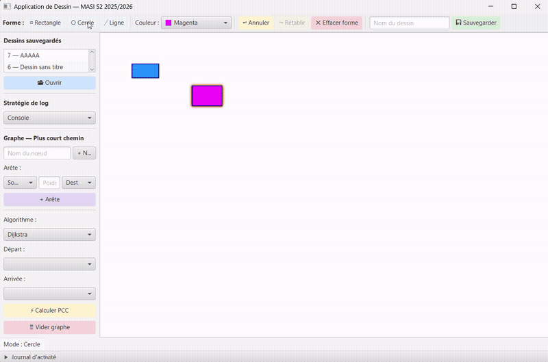
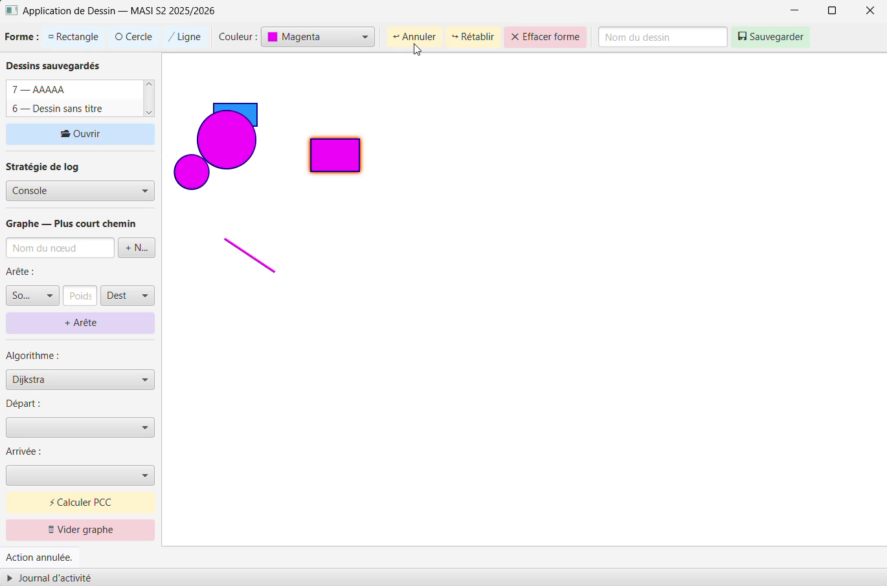
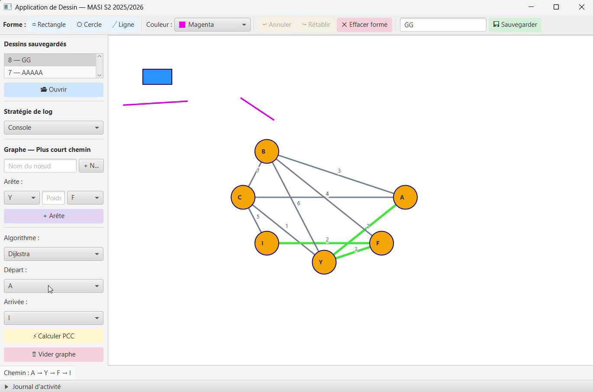
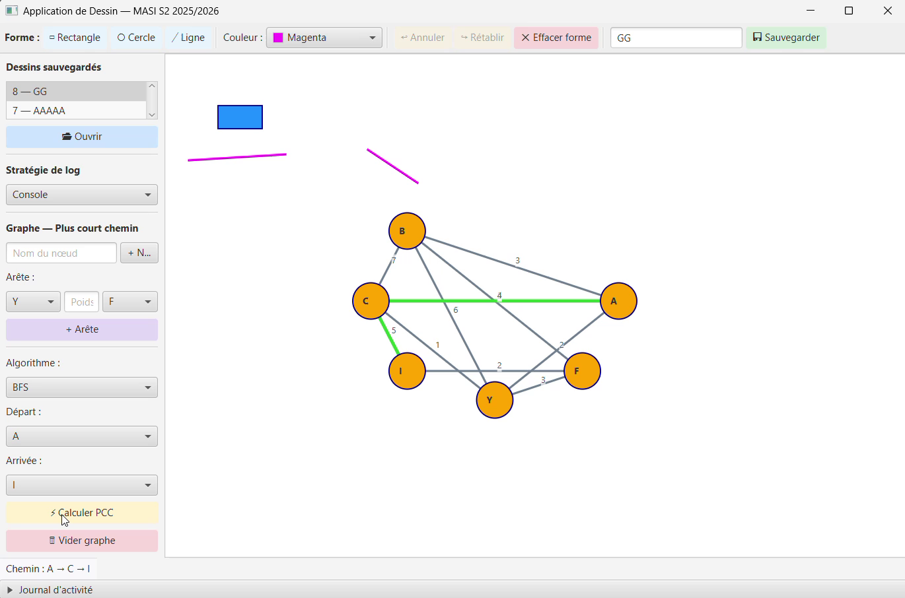

# 🎨 JavaFX Drawing App — 8 GoF Design Patterns

A desktop drawing application built with **Java 17 and JavaFX 21**, designed around **8 Gang-of-Four design patterns**.
Users can draw shapes, undo/redo their actions, save drawings to a SQLite database, switch logging strategies at runtime,
and compute shortest paths on an interactive graph (Dijkstra / BFS).




---

## ✨ Features

- **Draw shapes** — rectangles, circles and lines with the mouse, with a color picker
- **Undo / Redo** — full action history (add / delete shape)
- **Delete** the selected shape
- **Save & open drawings** — persisted in a local SQLite database (shapes, colors, borders)
- **Activity log** with a strategy chosen at runtime: **console**, **text file** or **database**
- **Graph module** — add nodes and weighted edges, then compute the **shortest path** with **Dijkstra** or **BFS**; the path is highlighted in green

## 📸 Screenshots

| Drawing | Shortest path — Dijkstra | Shortest path — BFS |
|---|---|---|
|  |  |  |

On the same graph, Dijkstra returns the lowest-**weight** path (A → Y → F → I) while BFS returns the path with the fewest **edges** (A → C → I).

---

## 🧩 Design patterns

| # | Pattern | Classes | Role in the application |
|---|---|---|---|
| 1 | **Singleton** | `DatabaseConnection`, `Logger` | One shared SQLite connection and one global logger |
| 2 | **Observer** | `Observable`, `Observer`, `DrawingCanvas` | The canvas notifies the logger and the UI log panel on every change |
| 3 | **Strategy** (logging) | `LogStrategy`, `ConsoleLogStrategy`, `FichierLogStrategy`, `DatabaseLogStrategy` | Switch the log destination at runtime from the UI |
| 3b | **Strategy** (algorithms) | `AlgorithmePCC`, `DijkstraStrategy`, `BFSStrategy`, `GrapheContext` | Swap the shortest-path algorithm without changing the graph code |
| 4 | **Decorator** | `FormeDecorator`, `FormeColoree`, `FormeBordure` | Stackable style layers (fill color, border) on top of any shape, persisted in the database |
| 5 | **Adapter** | `FormeMetier`, `FormeJFXAdapter` | Decouples the domain shape model from JavaFX rendering nodes |
| 6 | **Factory Method** | `FormeFactory`, `FormeFactoryProvider`, concrete factories | Creates the right shape from the selected tool |
| 7 | **Command** | `Command`, `AjouterFormeCommand`, `SupprimerFormeCommand`, `MainController` (invoker) | Encapsulates user actions; two stacks provide undo / redo |
| 8 | **Memento** | `Forme.Memento`, `Historique` (caretaker) | Snapshots a shape's state (position, color) and restores it without breaking encapsulation |

A detailed report (in French) with UML diagrams and explanations of every pattern is available in [`docs/Design_Patterns_Report_FR.pdf`](docs/Design_Patterns_Report_FR.pdf).

---

## 🏗️ Architecture

```
┌──────────────────────────────────────────────────────┐
│ PRESENTATION    MainController · DrawingApp · FXML   │
├──────────────────────────────────────────────────────┤
│ APPLICATION     DrawingCanvas · Command · Historique │
├──────────────────────────────────────────────────────┤
│ DOMAIN          Forme · Dessin · Decorator           │
│                 Factory · Adapter                    │
├──────────────────────────────────────────────────────┤
│ INFRASTRUCTURE  FormeDAO · DatabaseConnection        │
│                 Logger · LogStrategy · Graph         │
└──────────────────────────────────────────────────────┘
```

```
src/main/java/masi/
├── app/         JavaFX entry point, controller, drawing canvas
├── model/       Shapes (Forme, Rectangle, Cercle, Ligne) and Dessin
├── factory/     Factory Method
├── decorator/   Decorator
├── adapter/     Adapter
├── command/     Command (undo / redo)
├── memento/     Memento caretaker
├── observer/    Observer interfaces
├── strategy/    Logging strategies
├── singleton/   DatabaseConnection, Logger
├── dao/         SQLite persistence (DAO)
└── graphe/      Graph + Dijkstra / BFS strategies
```

---

## 🚀 Getting started

**Requirements:** JDK 17+ and Maven 3.8+ (JavaFX and the SQLite driver are downloaded by Maven).

```bash
git clone https://github.com/MaatarChaima/javafx-drawing-app-design-patterns.git
cd javafx-drawing-app-design-patterns
mvn clean javafx:run
```

The SQLite database (`dessin.db`) and the log file (`log.txt`) are created automatically on first launch.

---

## 👩‍💻 Authors

Academic mini-project — **Software Design Patterns** course, MASI, 2025/2026.

- **Chaima Maatar** — [GitHub](https://github.com/MaatarChaima)
- **Salha Hentati**
